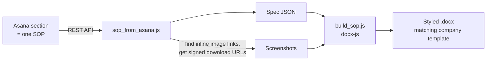

# SOP Generator (Asana → Word)

> One command turns an IT procedure written in Asana into a formatted Word document, with every screenshot downloaded and embedded automatically.

**Built for:** a facility services franchise, where I'm the sole IT person
**When:** June 2026
**Stack:** Node.js · Asana REST API · docx (docx-js) · Python helper scripts
**My role:** Designed and built it. Built with Claude Code as an AI pair programmer.

> The code points at my employer's Asana workspace, so it stays private. This page describes what I built and how.

---

## The problem

Our IT procedures live in an Asana project: each section is one SOP, each task is a step, with instructions and screenshots in the task notes. Turning those into clean Word documents for staff meant hours of copy and paste per SOP, mostly screenshots.

## How it works

- Reads a section's tasks from the Asana API and finds the inline screenshots in each task's notes.
- Downloads them through Asana's signed attachment URLs and caps oversized images to a readable width.
- Builds a Word document that matches the company SOP template (fonts, page size, bold step headers, bulleted steps).
- Options to split a combined section into separate remote and in-person documents, drop images for a text-only version, set a custom title, or use short aliases for common SOPs.
- The Asana token is read from a git-ignored file or an environment variable and never committed.

## Results

- Generated all **8** current SOP documents with **167 screenshots** embedded automatically.
- What used to take hours of copy and paste per SOP is now one command.
- I send these picture SOPs to users on tickets, which can turn a 10-minute phone call into a 20-second Teams message.

---

*Part of a set of tools I built as the sole IT person at a facility services franchise. See my [profile](https://github.com/Matteoinfl) for the others.*
